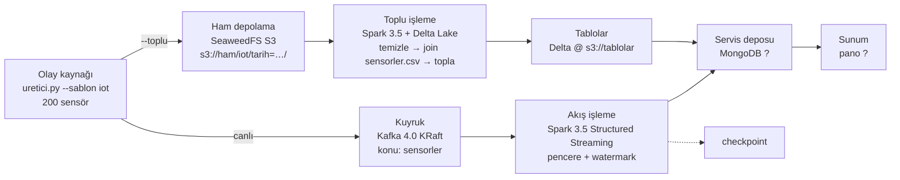

# Z0 — Mimari taslak

*Taslak (Adım 5). "?" olan yerler ilgili katman kurulup ölçülünce doldurulur; Adım 15'te son hâli.*

## Garanti tablosu

| Ok | Kaç kopya? | Sıra garantisi? | Ağ bölünürse? | Kit sadeleştirmesi → üretimde |
|---|---|---|---|---|
| Üretici → Kafka | ? | ? (anahtar başına bölüm içinde) | ? | tek düğüm, RF=1 → 3 düğüm, `min.insync.replicas=2` |
| Kafka → Spark Streaming | ? | ? | ? | ? |
| Üretici → S3 (toplu) | ? | — | ? | tek SeaweedFS düğümü → ? |
| S3 → Spark Batch → Delta | ? | — | ? | ? |
| Spark → MongoDB | ? | ? | ? | tek düğüm → replica set |
| MongoDB → Pano | ? | — | ? | ? |

Sürümler kitin `docker-compose.yml`'inden yazılacak (tahmin edilmeyecek).
